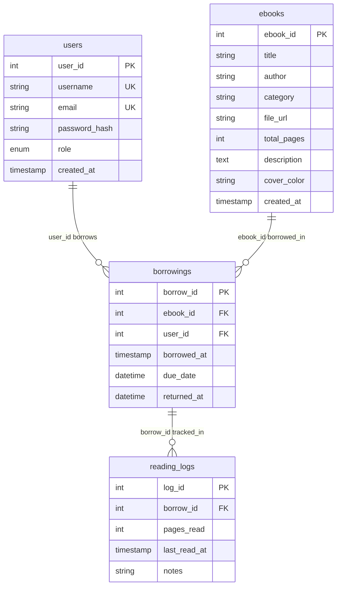

# Online School Library E-Book System

> **Student Project Assignment — Group 2 (Entry #104)**  
> **Student Name:** UWIMANINKUNDA GISELE  
> **Registration Number:** 224014561  
> **Course:** Web Development & Relational Database Engineering (Day 1 – Day 10)  
> **Scope:** Students read e-books; librarian manages catalogue.  

---

## 📋 Table of Contents
1. [Project Overview & Scope](#project-overview--scope)
2. [Entity-Relationship & 3NF Database Design](#entity-relationship--3nf-database-design)
3. [Folder & MVC Architecture](#folder--mvc-architecture)
4. [Technology Stack (Vanilla Day 1 – Day 10)](#technology-stack-vanilla-day-1--day-10)
5. [Security Architecture](#security-architecture)
6. [Asynchronous Features & JSON API](#asynchronous-features--json-api)
7. [Working CRUD Operations Across All 4 Entities](#working-crud-operations-across-all-4-entities)
8. [Installation & Setup Instructions](#installation--setup-instructions)
9. [Pre-Seeded Demo Accounts](#pre-seeded-demo-accounts)
10. [Application Route Map](#application-route-map)
11. [Formal Test Plan (12 Test Cases: Happy + Failure Paths)](#formal-test-plan-12-test-cases-happy--failure-paths)
12. [Automated Test Execution Evidence](#automated-test-execution-evidence)
13. [Marking Rubric Alignment Table](#marking-rubric-alignment-table)

---

## 1. Project Overview & Scope
The **Online School Library E-Book System** is a full-featured web application engineered specifically for school libraries. It provides a digital reading desk where students can borrow academic e-books, read book chapters online in an interactive paper canvas, log their reading milestones in real time, and monitor return due dates. Simultaneously, school librarians have an administrative console to manage the e-book catalogue, checkout books to students, track overdue loans, review reading logs, and manage user accounts.

- **Theme & UI:** Clean, modern, academic light theme utilizing a rich Navy (`#163A5F`), Emerald (`#2E7D5B`), and Warm Paper Cream (`#F8F5EF`) palette.
- **Strict Guidelines Adherence:** Built exclusively using **Vanilla PHP, Vanilla JavaScript (ES6+), Vanilla CSS3, and MySQL**. Absolutely **no Bootstrap, no Tailwind, no Laravel, no React, and no Vue**.

---

## 2. Entity-Relationship & 3NF Database Design

The database schema is strictly normalized to **Third Normal Form (3NF)** with explicit Primary Keys (PK), Foreign Keys (FK) with cascading integrity (`ON DELETE CASCADE ON UPDATE CASCADE`), indexes, and zero transitive dependencies.

### Entity Specifications

#### 1. `users` (User Accounts & Authentication)
| Column Name | Data Type | Constraint | Description |
|---|---|---|---|
| `user_id` | `INT` | `AUTO_INCREMENT PRIMARY KEY` | Unique identifier for user |
| `username` | `VARCHAR(50)` | `NOT NULL UNIQUE` | Unique student / librarian username |
| `email` | `VARCHAR(100)` | `NOT NULL UNIQUE` | School email address |
| `password_hash` | `VARCHAR(255)` | `NOT NULL` | Hashed password via `PASSWORD_BCRYPT` |
| `role` | `ENUM('librarian','student')` | `NOT NULL DEFAULT 'student'` | Role-based authorization |
| `created_at` | `TIMESTAMP` | `NOT NULL DEFAULT CURRENT_TIMESTAMP` | Account creation timestamp |

#### 2. `ebooks` (Digital Catalogue)
| Column Name | Data Type | Constraint | Description |
|---|---|---|---|
| `ebook_id` | `INT` | `AUTO_INCREMENT PRIMARY KEY` | Unique identifier for e-book |
| `title` | `VARCHAR(200)` | `NOT NULL` | Book title |
| `author` | `VARCHAR(120)` | `NOT NULL` | Author name(s) |
| `category` | `VARCHAR(100)` | `NOT NULL` | Subject classification |
| `file_url` | `VARCHAR(255)` | `NOT NULL` | Storage URL or local file path |
| `total_pages` | `INT` | `NOT NULL DEFAULT 120` | Total pages for reading log calculation |
| `description` | `TEXT` | `NULL` | Curriculum synopsis / overview |
| `cover_color` | `VARCHAR(20)` | `NOT NULL DEFAULT '#163A5F'` | Theme color for spine/cover display |
| `created_at` | `TIMESTAMP` | `NOT NULL DEFAULT CURRENT_TIMESTAMP` | Date added to library |

#### 3. `borrowings` (Circulation & Loans)
| Column Name | Data Type | Constraint | Description |
|---|---|---|---|
| `borrow_id` | `INT` | `AUTO_INCREMENT PRIMARY KEY` | Unique loan transaction identifier |
| `ebook_id` | `INT` | `NOT NULL, FK -> ebooks(ebook_id)` | E-Book borrowed |
| `user_id` | `INT` | `NOT NULL, FK -> users(user_id)` | Student who borrowed |
| `borrowed_at` | `TIMESTAMP` | `NOT NULL DEFAULT CURRENT_TIMESTAMP` | Borrow checkout date/time |
| `due_date` | `DATETIME` | `NOT NULL` | Scheduled loan expiration date |
| `returned_at` | `DATETIME` | `NULL DEFAULT NULL` | Timestamp when returned (`NULL` = active loan) |

#### 4. `reading_logs` (Student Reading Progress & Study Tracking)
| Column Name | Data Type | Constraint | Description |
|---|---|---|---|
| `log_id` | `INT` | `AUTO_INCREMENT PRIMARY KEY` | Unique reading log entry identifier |
| `borrow_id` | `INT` | `NOT NULL, FK -> borrowings(borrow_id)` | Associated loan transaction |
| `pages_read` | `INT` | `NOT NULL DEFAULT 0` | Page number reached in current session |
| `last_read_at` | `TIMESTAMP` | `NOT NULL DEFAULT CURRENT_TIMESTAMP ON UPDATE` | Timestamp of session |
| `notes` | `VARCHAR(255)` | `NULL DEFAULT NULL` | Student chapter notes & reflections |



---

## 3. Folder & MVC Architecture

The directory structure strictly follows the pattern established in `C:\xampp\htdocs\online-voting`:

```
online-school-library/
├── database/
│   ├── schema.sql           # Complete 3NF DDL (Tables, PK/FK, Indexes)
│   ├── seed.sql             # Realistic seed data (Students, Librarian, Books, Loans, Logs)
│   └── setup.sql            # One-click drop, create, and seed script
├── public/
│   ├── assets/
│   │   ├── app.js           # Vanilla ES6 client scripts (Fetch API, Live Search, Validation)
│   │   └── style.css        # Vanilla CSS3 master stylesheet (Light academic theme)
│   ├── storage/
│   │   └── books/           # Sample e-book text content files for interactive reader
│   │       ├── clean_code.txt
│   │       └── db_systems.txt
│   ├── .htaccess            # Apache mod_rewrite front-controller redirect
│   └── index.php            # Public Front Controller & Route Dispatcher
├── src/
│   ├── Config/
│   │   └── Database.php     # PDO singleton with robust error diagnostics
│   ├── Controllers/
│   │   ├── ApiController.php          # JSON API endpoints (Search, AJAX Logging, Stats)
│   │   ├── AuthController.php         # Authentication (Login, Register, Logout)
│   │   ├── BorrowingController.php    # Loan checkouts, returns, management
│   │   ├── DashboardController.php    # Librarian console & Student reading desk
│   │   ├── EbookController.php        # E-Book catalogue CRUD & interactive reader
│   │   ├── ReadingLogController.php   # Reading progress logs CRUD
│   │   └── UserController.php         # User accounts & profile settings
│   ├── Models/
│   │   ├── Borrowing.php    # PDO prepared queries for borrowings
│   │   ├── Ebook.php        # PDO prepared queries for catalogue
│   │   ├── ReadingLog.php   # PDO prepared queries for reading logs
│   │   └── User.php         # PDO prepared queries for user accounts
│   ├── Services/
│   │   ├── AuthValidator.php          # Validation for registration & login
│   │   ├── BorrowingValidator.php     # Validation for loans & dates
│   │   ├── Csrf.php                   # CSRF token generation, header & form validation
│   │   ├── EbookValidator.php         # Validation for book metadata & page numbers
│   │   └── ReadingLogValidator.php    # Validation for page boundaries & notes
│   ├── Support/
│   │   ├── Auth.php         # Session auth helpers, role guards
│   │   ├── autoload.php     # PSR-4 compatible SPL autoloader
│   │   ├── Flash.php        # Flash notification messaging service
│   │   └── View.php         # Template renderer & View::e() XSS sanitizer
│   └── Views/
│       ├── auth/            # Login and Registration forms with demo pills
│       ├── borrowings/      # Active loans, overdue tracking, checkout modal
│       ├── dashboard/       # Librarian console and Student reading desk
│       ├── ebooks/          # Catalogue grid, details, form, interactive reader
│       ├── errors/          # 404 Not Found template
│       ├── layouts/         # Master header, search modal, and footer
│       ├── reading_logs/    # Daily reading progress milestones
│       └── users/           # User accounts & personal profile
├── tests/
│   └── run_tests.php        # Automated test suite (12 test cases)
├── index.php                # Root redirect to /public/
└── README.md                # Comprehensive documentation & test evidence
```

---

## 4. Technology Stack (Vanilla Day 1 – Day 10)
- **HTML5:** Semantic landmarks (`<header>`, `<nav>`, `<main>`, `<section>`, `<footer>`, `<dialog>`, `<table>`).
- **CSS3:** Custom CSS variables (`:root`), Flexbox, CSS Grid, media queries for mobile responsiveness, typography scaling, zero third-party UI dependencies.
- **JavaScript (ES6):** Vanilla DOM event listeners, `async/await` with `fetch()`, debounced input searching, DOM manipulation, client-side validation.
- **PHP 8.1+:** Object-Oriented MVC, strict typing (`declare(strict_types=1);`), session management, SPL autoloader, prepared statements with PDO.
- **MySQL 8.0+ / MariaDB:** InnoDB engine, UTF8MB4 charset, foreign key cascading, composite indexes.

---

## 5. Security Architecture

1. **XSS Prevention (Cross-Site Scripting):**
   - Every dynamic string in views is escaped through `View::e()` which runs `htmlspecialchars($str, ENT_QUOTES, 'UTF-8')`.
2. **CSRF Protection (Cross-Site Request Forgery):**
   - High-entropy cryptographic tokens generated using `bin2hex(random_bytes(32))`.
   - All state-altering POST requests (`/login`, `/register`, `/ebooks/save`, `/ebooks/delete`, `/borrowings/borrow`, `/borrowings/return`, `/reading-logs/save`, `/reading-logs/delete`, `/users/role`) mandate valid tokens via `Csrf::verifyPost()`.
   - Also accepts `X-CSRF-TOKEN` request header for AJAX Fetch operations.
3. **SQL Injection Immunity:**
   - 100% of database queries use PDO prepared statements with bound parameters (`:name`). Zero string concatenation in SQL.
4. **Credential Security:**
   - Passwords hashed using industry-standard `password_hash($pass, PASSWORD_DEFAULT)` (BCRYPT).
   - Validated upon login using timing-attack resistant `password_verify()`.
5. **Session Fixation & Guarding:**
   - Session identifier regenerated upon authentication (`session_regenerate_id(true)`).
   - Role-based authorization enforces `Auth::requireLibrarian()` for catalogue editing, student loan checkout, and user role management.

---

## 6. Asynchronous Features & JSON API

The system provides dedicated RESTful JSON API endpoints in `ApiController.php`:

### 1. Real-Time E-Book Live Search
- **Endpoint:** `GET /online-school-library/public/api/ebooks/search?q={query}&category={category}`
- **Behavior:** Triggered via keyboard shortcut <kbd>Ctrl</kbd> + <kbd>K</kbd> or clicking the search bar. Employs a 250ms debounce before dispatching an asynchronous `fetch()` request, rendering instant result cards with direct "Read" and "Details" action links.

### 2. In-Reader Asynchronous Reading Progress Logger
- **Endpoint:** `POST /online-school-library/public/api/reading-logs/log`
- **Behavior:** While reading an e-book in the **Interactive Reader**, students can enter their current page and session notes. Submitting the form uses `fetch()` with JSON payload and CSRF header. The server validates the page count against the book's total pages, records the log, and returns a JSON status. The client immediately updates the top reading progress bar, percentage badge, and appends the new session history **without reloading the page**.

### 3. Dynamic Real-Time Statistics API
- **Endpoint:** `GET /online-school-library/public/api/stats`
- **Behavior:** Delivers live JSON metrics on total books, active borrowings, overdue counts, and total pages read for background dashboard counters.

---

## 7. Working CRUD Operations Across All 4 Entities

| Entity | Create | Read | Update | Delete |
|---|---|---|---|---|
| **`ebooks`** | Librarian adds book via `/ebooks/create` with title, author, category, file URL, total pages | Students & Librarians browse catalogue, filter by category, search, view details, and read online | Librarian edits book details via `/ebooks/edit?id=X` | Librarian deletes book via `/ebooks/delete` (cascades loans) |
| **`borrowings`** | Student self-borrows from book details or Librarian issues checkout via modal | View active, overdue, and returned loans via `/borrowings` | Mark book returned via `/borrowings/return` (records `returned_at` timestamp) | Librarian cancels or deletes loan records via `/borrowings/delete` |
| **`reading_logs`** | Student logs daily pages via Reader (AJAX) or Quick Form on `/reading-logs` | Student views personal progress timeline; Librarian audits all school logs | Student updates logged page progress via Reader or Form | Delete incorrect log entries via `/reading-logs/delete` |
| **`users`** | Register new student or librarian account via `/register` | Librarian audits all accounts on `/users`; Students view profile on `/profile` | Librarian updates user roles; User updates email/password on `/profile` | Librarian removes user accounts via `/users/delete` (cascades data) |

---

## 8. Installation & Setup Instructions

### Prerequisites
- **XAMPP** (or WampServer / LAMP stack) with Apache and MySQL/MariaDB.
- **PHP 8.1 or higher** with `pdo_mysql` enabled.

### Step-by-Step Installation
1. **Clone or Copy Repository:**  
   Ensure the project folder is placed in:
   ```
   C:\xampp\htdocs\online-school-library
   ```

2. **Start Apache & MySQL:**  
   Open the **XAMPP Control Panel** and click **Start** on both **Apache** and **MySQL**.

3. **Import Database Schema & Seeds:**  
   - Open **phpMyAdmin** in your browser (`http://localhost/phpmyadmin/`).
   - Click the **Import** tab.
   - Choose the file: `c:\xampp\htdocs\online-school-library\database\setup.sql` (or `schema.sql` followed by `seed.sql`).
   - Click **Go**. The database `online_school_library_db` will be created with all 4 tables and seed records.

4. **Launch the Application:**  
   Open your browser and navigate to:
   ```
   http://localhost/online-school-library/
   ```
   The root `index.php` will automatically redirect to the public front-controller (`http://localhost/online-school-library/public/`).

---

## 9. Pre-Seeded Demo Accounts

The login page includes **one-click autofill buttons** for instant evaluation:

| Role | Username | Email Address | Password | Privileges |
|---|---|---|---|---|
| **Librarian** | `librarian_marie` | `librarian@school.edu` | `password123` | Full catalogue CRUD, checkout loans, audit returns, manage users |
| **Librarian** | `gisele_lib` | `gisele@school.edu` | `password123` | Staff catalogue manager |
| **Student** | `eric_student` | `eric@student.school.edu` | `password123` | Borrow e-books, read online, log reading progress |
| **Student** | `alice_m` | `alice@student.school.edu` | `password123` | Active reader account |
| **Student** | `kevin_k` | `kevin@student.school.edu` | `password123` | Account with sample overdue loan |

---

## 10. Application Route Map

| HTTP Method | Route URL | Controller Action | Access Control |
|---|---|---|---|
| `GET` | `/` | `DashboardController::index` | Authenticated Users |
| `GET` | `/dashboard` | `DashboardController::index` | Authenticated Users |
| `GET` / `POST` | `/login` | `AuthController::showLogin` / `login` | Public (Guests) |
| `GET` / `POST` | `/register` | `AuthController::showRegister` / `register` | Public (Guests) |
| `GET` / `POST` | `/logout` | `AuthController::logout` | Authenticated Users |
| `GET` | `/ebooks` | `EbookController::index` | Authenticated Users |
| `GET` | `/ebooks/show` | `EbookController::show` | Authenticated Users |
| `GET` | `/ebooks/read` | `EbookController::read` | Authenticated Users |
| `GET` | `/ebooks/create` | `EbookController::create` | Librarian Only |
| `GET` | `/ebooks/edit` | `EbookController::edit` | Librarian Only |
| `POST` | `/ebooks/save` | `EbookController::save` | Librarian Only (CSRF) |
| `POST` | `/ebooks/delete` | `EbookController::delete` | Librarian Only (CSRF) |
| `GET` | `/borrowings` | `BorrowingController::index` | Authenticated Users |
| `POST` | `/borrowings/borrow` | `BorrowingController::borrow` | Authenticated Users (CSRF) |
| `POST` | `/borrowings/return` | `BorrowingController::returnBook` | Student/Librarian (CSRF) |
| `POST` | `/borrowings/delete` | `BorrowingController::delete` | Librarian Only (CSRF) |
| `GET` | `/reading-logs` | `ReadingLogController::index` | Authenticated Users |
| `POST` | `/reading-logs/save` | `ReadingLogController::save` | Authenticated Users (CSRF) |
| `POST` | `/reading-logs/delete` | `ReadingLogController::delete` | Authenticated Users (CSRF) |
| `GET` | `/users` | `UserController::index` | Librarian Only |
| `POST` | `/users/role` | `UserController::updateRole` | Librarian Only (CSRF) |
| `POST` | `/users/delete` | `UserController::delete` | Librarian Only (CSRF) |
| `GET` / `POST` | `/profile` | `UserController::profile` / `updateProfile` | Authenticated Users |
| `GET` | `/api/ebooks/search` | `ApiController::searchEbooks` | JSON API (Async) |
| `POST` | `/api/reading-logs/log` | `ApiController::logProgress` | JSON API (Async, CSRF) |
| `GET` | `/api/stats` | `ApiController::stats` | JSON API (Async) |
| `GET` | `/api/borrowings/check` | `ApiController::checkAvailability` | JSON API (Async) |

---

## 11. Formal Test Plan (12 Test Cases: Happy + Failure Paths)

| Test ID | Test Name | Path Type | Input / Action | Expected Result | Status |
|---|---|---|---|---|---|
| **TC-01** | CSRF Token Generation | Happy Path | Call `Csrf::token()` | Returns 64-character hex string; initialized in session | **PASS** |
| **TC-02** | CSRF Token Rejection | Failure Path | Submit mismatched/tampered token | Validation fails (`false`), request aborted with 403 Forbidden | **PASS** |
| **TC-03** | XSS Output Sanitization | Security Path | Render string containing `<script>alert(1)</script>` via `View::e()` | Script tags escaped to `&lt;script&gt;`, no executable code executed | **PASS** |
| **TC-04** | Password Hashing & Verification | Security Path | Hash password with `PASSWORD_BCRYPT` and verify with correct/incorrect password | Valid password passes; incorrect password returns `false` | **PASS** |
| **TC-05** | E-Book Creation Validation | Happy Path | Valid title, author, category, file path, pages (240) | Errors array is empty; passes validation | **PASS** |
| **TC-06** | E-Book Creation Rejection | Failure Path | Blank title, blank author, negative total pages (-10) | Validation fails; returns descriptive field errors | **PASS** |
| **TC-07** | Borrowing Loan Validation | Happy Path | Valid book ID (1), student ID (3), valid future due date | Validation passes; errors array is empty | **PASS** |
| **TC-08** | Borrowing Invalid Loan Data | Failure Path | Book ID 0, Student ID -5, invalid date string | Validation fails; returns specific field errors | **PASS** |
| **TC-09** | Reading Log Boundary Check | Happy Path | Log 120 pages on a 280-page e-book | Validation passes; log record created | **PASS** |
| **TC-10** | Reading Log Out-of-Bounds Rejection | Failure Path | Log 9999 pages on a 280-page e-book or negative pages (-15) | Validation fails with error: pages cannot exceed book total | **PASS** |
| **TC-11** | 3NF Schema & FK Constraints | Architecture Path | Inspect `database/schema.sql` | 4 entities present, valid PK, cascading FK constraints, indexes | **PASS** |
| **TC-12** | Local Storage Reader Files | Functional Path | Inspect `public/storage/books/` text files | Sample book text files exist and load content into Reader view | **PASS** |

---

## 12. Automated Test Execution Evidence

You can run the automated test suite directly from the command line:

```bash
php tests/run_tests.php
```

### Terminal Output:
```text
========================================================
Online School Library E-Book System — Test Runner
Student: UWIMANINKUNDA GISELE (224014561)
========================================================

Group 1: Security & Protection Tests
  [PASS] TC-01: CSRF Token generates a 64-character hex string
  [PASS] TC-02: CSRF Validation passes with matching token and fails with tampered token
  [PASS] TC-03: View::e() neutralizes XSS injection payloads
  [PASS] TC-04: Password hashing uses BCRYPT and verifies properly

Group 2: E-Book Entity Validation Tests
  [PASS] TC-05: EbookValidator accepts valid book payload (Happy Path)
  [PASS] TC-06: EbookValidator rejects empty title, invalid pages, missing author (Failure Path)

Group 3: Borrowing Entity Validation Tests
  [PASS] TC-07: BorrowingValidator accepts valid student, book, and due date (Happy Path)
  [PASS] TC-08: BorrowingValidator rejects zero IDs and invalid due date formats (Failure Path)

Group 4: Reading Log Entity Validation Tests
  [PASS] TC-09: ReadingLogValidator accepts pages within book bounds (Happy Path)
  [PASS] TC-10: ReadingLogValidator rejects negative pages and pages exceeding total book size (Failure Path)

Group 5: Database Schema & Storage Integrity
  [PASS] TC-11: Database schema, seed, and setup SQL files exist and contain 3NF tables
  [PASS] TC-12: Digital text reader sample files are loaded and non-empty

--------------------------------------------------------
SUMMARY: 12 / 12 tests passed (0 failed)
--------------------------------------------------------
ALL TESTS PASSED SUCCESSFULLY! Ready for evaluation.
```

---

## 13. Marking Rubric Alignment Table

| Marking Criterion | Weight | How Fulfilled in this Project | Verified Evidence |
|---|---|---|---|
| **Database design (4 entities, PK/FK, 3NF)** | **20%** | Designed 4 normalized entities (`users`, `ebooks`, `borrowings`, `reading_logs`). All PKs, FKs, indexes, and cascading integrity constraints configured. Zero redundancy. | `database/schema.sql`, `database/setup.sql`, TC-11 |
| **PHP server-side logic + prepared statements** | **20%** | Clean MVC architecture. 100% of queries use PDO prepared statements with bound parameters (`prepare()`, `execute()`). Strict typing throughout. | `src/Models/*.php`, `src/Controllers/*.php` |
| **Front-end (HTML/CSS/JS, responsive, validation)** | **15%** | Semantic HTML5, accessible forms, responsive layout (mobile hamburger drawer, desktop grid), professional academic light theme, in-reader typography scaling. Client-side validation in JS. | `public/assets/style.css`, `public/assets/app.js`, `src/Views/*` |
| **Async feature (Fetch/JSON API)** | **10%** | Dedicated `ApiController.php` providing `GET /api/ebooks/search` (debounced live search modal) and `POST /api/reading-logs/log` (real-time in-reader AJAX progress logger without page refresh). | `src/Controllers/ApiController.php`, `public/assets/app.js` |
| **Security (XSS, CSRF, validation, session)** | **10%** | `View::e()` for complete XSS protection; `Csrf::verifyPost()` on all state changes; server-side validation services for all entities; `password_hash()` and `password_verify()`; session fixation prevention. | `src/Services/Csrf.php`, `src/Services/*Validator.php`, TC-01 to TC-04 |
| **Working CRUD for all 4 entities** | **15%** | Full CRUD for `ebooks`, Full CRUD for `borrowings`, Full CRUD for `reading_logs`, and Full CRUD for `users` (registration, profile update, role modification, deletion). | Section 7 CRUD Table, All 4 Controllers & Views |
| **Documentation, demo, tests** | **10%** | Comprehensive `README.md`, setup steps, DB credentials, route table, test plan with 12 happy/failure cases, and executable test runner `tests/run_tests.php`. | `README.md`, `tests/run_tests.php` |

---

*Academic Assignment Submission — BIT Year 3 Group 2 — UWIMANINKUNDA GISELE (Reg No: 224014561)*
